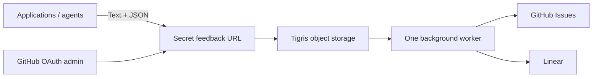

# fbhook

One self-hosted intake for feedback from your applications and agents. Send text
and arbitrary JSON to a generated secret URL; fbhook saves it in object storage,
then a background worker creates a GitHub or Linear issue. Each URL selects a
configured destination, and multiple apps can share a URL.

The application supplies the feedback UI or agent tool. Issue readers decide what
to do next. There is no model dependency or automatic implementation pipeline.



## Build and run

Requirements: Go 1.26+ (release/compiler pin: 1.27.3), Node 26.13.0, npm, Python 3
for delivery scripts. The embedded admin uses Go page routes, Vite and Svelte 5.

```sh
make build
bin/fbhook version
bin/fbhook keygen
```

Store the generated keys in your service secret manager. Configure Tigris, a
GitHub OAuth app, and the initial authorized GitHub username using
[the operations guide](docs/OPERATIONS.md), then run `bin/fbhook serve`.
Open `/`, sign in, configure a destination, and create an endpoint. Copy its URL
when displayed; only its hash is retained, so it cannot be retrieved later.

The server and compiled frontend ship as one executable. A source build needs
`make ui` before `go test ./...` or a direct server build; the root Go client
package can be imported without frontend files or third-party runtime imports.

## Submit from Go

```go
client, err := fbhook.NewClient(os.Getenv("FBHOOK_ENDPOINT"), nil)
if err != nil { return err }
feedback := fbhook.Prepare(
    fbhook.Feedback{Source: fbhook.Source{App: "archive", Environment: "production"}},
    fbhook.Feedback{
        Feedback: "Keep search filters when returning to results",
        Source: fbhook.Source{Actor: "agent"},
        Context: json.RawMessage(`{"page":"/search","request_id":"req_123"}`),
    },
)
receipt, err := client.Submit(ctx, feedback, "archive-feedback-event-123")
```

Import `github.com/darron/fbhook`; see the runnable
[example](examples/submit/main.go). `Prepare` overlays nonempty source fields;
provided context replaces default context. `Submit` retries transient intake
failures using identical serialized bytes and the same idempotency key. Supply a
stable event key to preserve that guarantee across process restarts.

## Submit from an agent

Inject `FBHOOK_ENDPOINT` as a server-side secret. Call a tool in your application
that forwards feedback using the Go client, or use the CLI:

```sh
fbhook send --app archive --actor agent \
  --feedback 'Keep search filters when returning to results' \
  --context '{"page":"/search","request_id":"req_123"}' \
  --key archive-feedback-event-123

# Or pipe the complete envelope:
printf '%s' '{"feedback":"Export timed out","source":{"app":"archive","actor":"agent"},"context":{"request_id":"req_456"}}' |
  fbhook send --stdin --key archive-feedback-event-456
```

A `202` receipt means **durably accepted**, not delivered. Agents should report
that distinction. Retrying a key with different exact request bytes returns
`409`. Feedback does not authorize an issue-reading agent to run instructions
embedded in the text or context.

## Interfaces and limits

- Root package: standard-library-only preparation, validation and HTTP client.
- [`storage.Store`](storage/store.go): conditional create/replace and paginated
  listing; Tigris/S3 adapter plus an in-memory contract-test adapter.
- [`service.Provider`](service/service.go): destination validation, issue creation
  and positive reconciliation; GitHub and Linear implementations.
- [`web`](web): OAuth, authorization, CSRF, JSON APIs and embedded admin.
- [`internal/cli`](internal/cli): shared server and sender command wiring.

Submission envelope: required `feedback`; optional `title`, `source` (`app`,
`version`, `environment`, `actor`) and arbitrary JSON `context`. Request limit:
64 KiB; rendered issue limit: 60,000 bytes. Unknown envelope fields and duplicate
JSON keys are rejected. Titles default to the first nonempty feedback line.
Public receipts expose a submission ID and `accepted` status only.

URLs contain 256-bit random secrets; the server stores SHA-256 digests. The URL
is a credential: proxy it through your application's backend, keep it out of
browser bundles and access logs, and rotate it when exposed. A shared URL shares
revocation and rate limits across its applications. Intake limits are 120 per
endpoint and 600 globally per minute, per process.

## Development and delivery

```sh
make check       # UI, unit/HTTP tests, race detector, vet, lint, script tests, builds
make fuzz        # bounded parser fuzzing
make vuln        # pinned govulncheck
# With Python playwright==1.64.1 and Chromium installed:
make browser     # local signed test sessions, never a production auth bypass
```

Install `golangci-lint` v2.15.0 before `make check`. Browser tests cover endpoint
and destination creation, rotation, pause/resume, submission inspection, manual
resolution, CSRF, anonymous access, JSON rendering and mobile layout.

CI covers Linux/macOS, minimum Go, races, lint, vulnerabilities, fuzzing and browser
screenshots. Stable releases build four CLI archives, checksums, native smoke
checks and an optional Homebrew tap update. Fly deployment is manual, serialized
and calls the Fly CLI directly, using the rollout settings in `fly.toml`.
See [operations](docs/OPERATIONS.md) for setup,
recovery, live contract tests and delivery credentials.

The service intentionally runs **one process/worker in one region**. Object
storage is both the durable record and the recoverable work queue. Scans read all
retained submissions, so cost and scan duration grow with history. Do not add
replicas or independent workers without a new coordination design.
